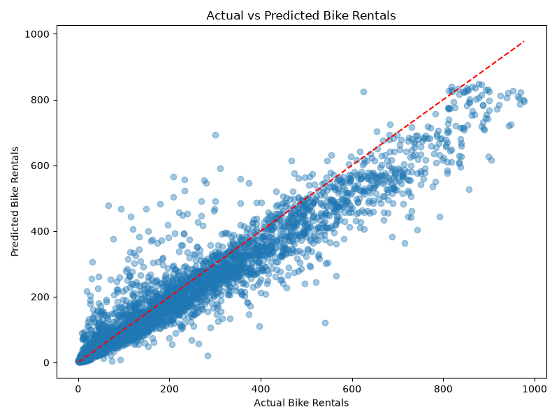
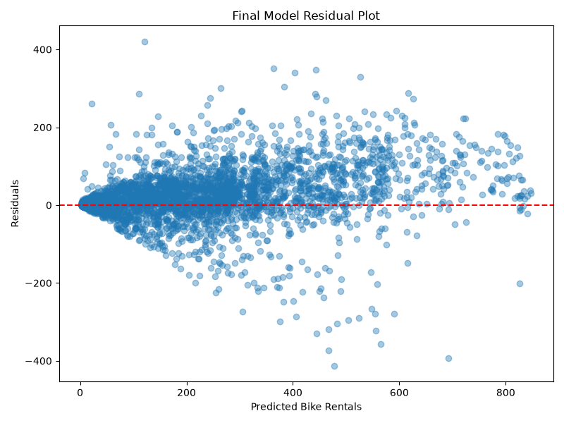
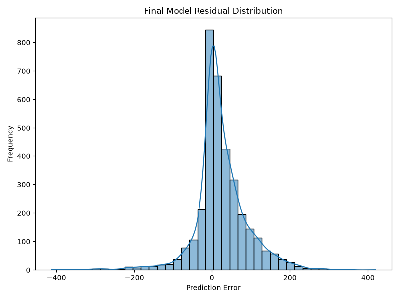
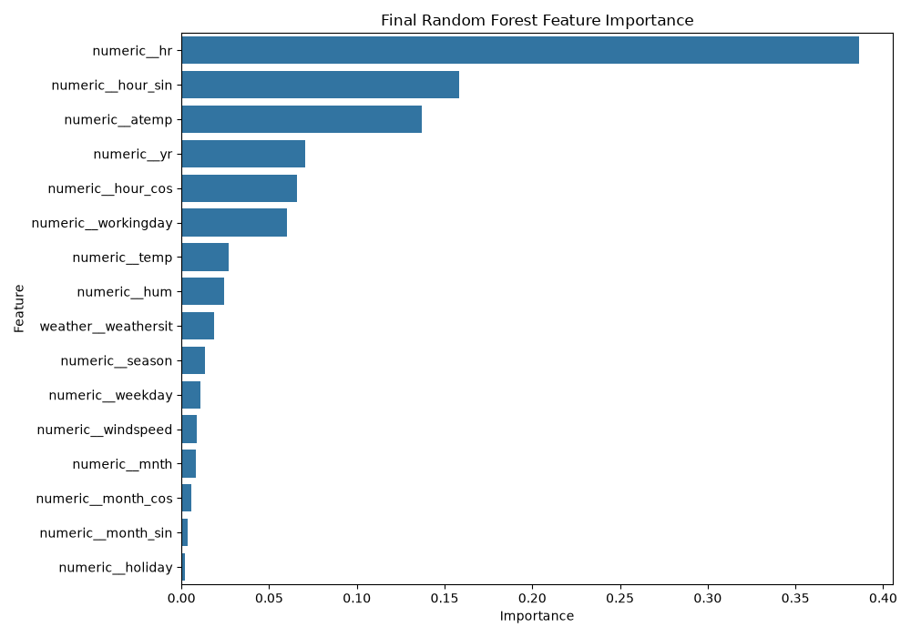

# Bike Sharing Demand Analysis and Prediction

**Course:** IDSE  
**Author:** SATHWIKA, EC24B1097 
**Repository:** https://github.com/Sathwika-Sonta/Bike_Sharing_IDSE

---

## Abstract

Bike-sharing systems need to know how many bikes will be rented in each hour so they can place and maintain bikes in advance. This project analyses the hourly Capital Bikeshare data (Washington D.C., 2011 to 2012) from the UCI Machine Learning Repository and builds a model to predict hourly rental demand. The dataset supplied for the assignment is a deliberately corrupted copy, so a large part of the work is detecting and repairing data-quality problems. After cleaning, exploratory analysis and feature engineering, three regression models (Linear Regression, Decision Tree and Random Forest) were trained on the first 80% of days and tested on the last 20%. The final Random Forest reached an MAE of 47.40, an RMSE of 72.66 and an R² of 0.8913 on the held-out period.

---

## 1. Introduction

### 1.1 Motivation
Bike sharing is affected by time of day, season, weather and whether the day is a working day. Operators that can forecast demand can rebalance bikes between stations, schedule maintenance and avoid both empty and overfull docks.

### 1.2 Objectives
- Assess and repair the quality of the messy hourly dataset.
- Understand how time and weather influence demand.
- Build and compare regression models that predict `cnt`, the hourly rental count.
- Evaluate them honestly on a later, unseen period.

---

## 2. Dataset

| Item | Description |
|---|---|
| Source | UCI Machine Learning Repository, Bike Sharing Dataset (Fanaee-T, 2013) |
| File | `data set/hour_messy.csv` (corrupted copy of the hourly data) |
| Records after cleaning | 17,379 hourly records (13,891 train and 3,488 test) |
| Target | `cnt`: total rentals in the hour (`casual + registered`) |

**Original columns:** `instant`, `dteday`, `season`, `yr`, `mnth`, `hr`, `holiday`, `weekday`, `workingday`, `weathersit`, `temp`, `atemp`, `hum`, `windspeed`, `casual`, `registered`, `cnt`.

`temp`, `atemp`, `hum` and `windspeed` are normalised to the range 0 to 1. `weathersit` is a category from 1 (clear) to 4 (heavy rain/snow).

---

## 3. Data Quality Assessment and Cleaning

The file was first inspected for its shape, data types, missing values, duplicates and value ranges. The following problems were found and handled.

| Problem | Detection | Treatment |
|---|---|---|
| Duplicate records | `duplicated()` | Exact duplicate rows removed |
| Mixed or invalid date formats | `pd.to_datetime(format="mixed", errors="coerce")` | Dates parsed to datetime; rows that could not be parsed were dropped |
| Out-of-range `temp`, `atemp`, `hum`, `windspeed` | Values below 0 or above 1 | Set to missing, then imputed |
| Missing values | `isnull().sum()` | Median for numeric columns, most frequent value for `weathersit` |
| Inconsistent totals | `casual + registered != cnt` (15 rows) | `cnt` recomputed as `casual + registered` |
| Wrong data type | `weathersit` stored as float | Converted to integer category |

**Assumption.** When a total did not match, `casual` and `registered` were treated as correct and `cnt` was recomputed. If instead `cnt` was the intact value, this correction would introduce errors into the target. This is a limitation of the cleaning and is stated again in Section 9.

**Preventing leakage.** In the final pipeline the imputation is part of a scikit-learn `Pipeline`, so the medians and modes are learned from the training data only and then applied to the test data.

**Sanity check.** After cleaning, the training and test sets together contain 17,379 records, which matches the size of the original UCI hourly dataset. This suggests the repairs restored the data without losing rows.

---

## 4. Exploratory Data Analysis

The analysis examined summary statistics, average rentals by hour, month, weather and day type, correlations between numeric variables, and the distribution of the target.

Typical findings for this dataset, which should be checked against the plots produced by `main.py`:

- **Hour of day:** on working days demand shows two peaks, in the morning and in the late afternoon, matching commuting hours. Demand is lowest overnight.
- **Month and season:** demand is higher in warmer months and lower in winter.
- **Weather:** average demand falls as the weather situation worsens (clear, then mist, then light rain or snow).
- **Working vs non-working days:** the commuting pattern appears only on working days; non-working days have a single midday peak.
- **Correlations:** temperature (and the closely related `atemp`) is positively correlated with demand, while humidity is negatively correlated. `temp` and `atemp` are strongly correlated with each other.
- **Target distribution:** `cnt` is right-skewed: many low-demand hours and a long tail of high-demand hours.

---

## 5. Feature Engineering

Hour and month are cyclic: hour 23 is next to hour 0, and December is next to January. Plain numbers hide this, so four features were added:

```
hour_sin  = sin(2π · hr / 24)          hour_cos  = cos(2π · hr / 24)
month_sin = sin(2π · (mnth − 1) / 12)  month_cos = cos(2π · (mnth − 1) / 12)
```

**Final model inputs (16 features):** `season`, `yr`, `mnth`, `hr`, `holiday`, `weekday`, `workingday`, `weathersit`, `temp`, `atemp`, `hum`, `windspeed`, `hour_sin`, `hour_cos`, `month_sin`, `month_cos`.

**Removed from the inputs:** `cnt` (target), `casual` and `registered` (they add up to the target and would leak it), `instant` (a row index) and `dteday` (used only for sorting and splitting).

---

## 6. Train-Test Split

A random split would place hours from the same day in both sets and flatter the results. Instead, the data was sorted by date and hour, and the **first 80% of unique days** were used for training and the **last 20% of days** for testing. Whole days are kept together, and the script checks that the two date sets do not overlap.

| Set | Records |
|---|---|
| Training | 13,891 |
| Testing | 3,488 |

---

## 7. Models

| Model | Configuration |
|---|---|
| Linear Regression | `StandardScaler` followed by `LinearRegression` |
| Decision Tree | `max_depth=12`, `min_samples_leaf=5`, `random_state=42` |
| Random Forest | `n_estimators=100`, `max_depth=20`, `min_samples_leaf=2`, `random_state=42`, `n_jobs=-1` |
| Baseline | `DummyRegressor(strategy="mean")`: always predicts the training mean |

The final pipeline combines a `ColumnTransformer` (median imputation for numeric columns, most-frequent imputation for `weathersit`) with the Random Forest, so a single saved object (`bike_sharing_final_model.pkl`) can be loaded and used on new raw inputs.

**Metrics used**

- **MAE:** average absolute error, in rentals per hour.
- **RMSE:** square root of the mean squared error; penalises large misses more.
- **R²:** share of the variance in demand explained by the model.

---

## 8. Results

### 8.1 Model comparison (held-out test period)

| Model | MAE | RMSE | R² |
|---|---|---|---|
| **Random Forest (final)** | **47.40** | **72.66** | **0.8913** |
| Mean baseline | TBD | TBD | TBD |
| Linear Regression | TBD | TBD | TBD |
| Decision Tree | TBD | TBD | TBD |

*Fill the TBD values from the output of `main.py` or from `model_comparison_results.csv`.*

An RMSE of about 73 rentals should be read against the average demand, which is roughly 190 rentals per hour in the original dataset. The R² of 0.89 means the model explains about 89% of the variation in hourly demand on days it has not seen.



### 8.2 Residual analysis

The residual plot shows prediction error against predicted value, and the histogram shows how the errors are distributed. Errors should be centred near zero; the spread typically grows for high-demand hours, which are harder to predict.





### 8.3 Feature importance

The Random Forest ranks features by how much they reduce prediction error. Hour-related features (`hr`, `hour_sin`, `hour_cos`) are expected to dominate, followed by temperature and working-day information. Check the ranking in `final_feature_importance.csv`.



*Top features from this run: TBD.*

---

## 9. Limitations

1. **Target correction assumption.** `cnt` was rebuilt from `casual + registered`, assuming those columns were intact.
2. **No hyperparameter tuning or cross-validation.** Settings were chosen by hand.
3. **Test set used for model comparison.** The three candidate models were compared on the same test set that is reported as the final result, so the reported score is slightly optimistic.
4. **Weak baseline.** Predicting the global mean is easy to beat. A baseline using the average demand for each (working day, hour) pair would be a fairer reference.
5. **Time extrapolation.** The test period comes after the training period. Tree-based models cannot extrapolate trends such as the growth in usage between the two years.
6. **Observed, not forecast, weather.** The model uses the weather that actually occurred; a real deployment would depend on forecasts that are less accurate.
7. **Date parsing.** Mixed-format dates were parsed automatically. Ambiguous strings such as `03/04/2011` could be misread, and rows with unparseable dates were dropped rather than recovered.

---

## 10. Future Work

- Time-series cross-validation (`TimeSeriesSplit`) and a systematic hyperparameter search.
- A stronger baseline and a final comparison against it.
- Gradient boosting models such as XGBoost or LightGBM.
- Lag features: demand in the previous hours and the same hour on previous days.
- Separate models for casual and registered users, whose behaviour differs.
- Recover rows with invalid dates using the `instant` index.

---

## 11. Conclusion

The project shows the full workflow from a corrupted dataset to a deployable model: systematic data-quality checks and repairs, exploratory analysis, cyclic feature engineering, a leakage-free chronological split, model comparison and evaluation. A Random Forest predicts hourly bike demand on unseen later days with an MAE of 47.40 and an R² of 0.8913. The main directions for improvement are better validation (time-series cross-validation), a stronger baseline and lag features.

---

## 12. Reproducibility

```bash
git clone https://github.com/Sathwika-Sonta/Bike_Sharing_IDSE.git
cd Bike_Sharing_IDSE
pip install -r requirements.txt
python main.py
```

**Libraries:** Python, pandas, NumPy, Matplotlib, Seaborn, scikit-learn, joblib.  
**Random seed:** `random_state=42` for all models.

**Files generated:** `bike_sharing_final_model.pkl`, `final_random_forest_predictions.csv`, `final_feature_importance.csv`, `final_actual_vs_predicted.png`, `final_residual_plot.png`, `final_residual_distribution.png`, `final_feature_importance.png`.

---

## References

1. Fanaee-T, H. (2013). *Bike Sharing*. UCI Machine Learning Repository. https://doi.org/10.24432/C5W894
2. Fanaee-T, H. and Gama, J. (2014). Event labeling combining ensemble detectors and background knowledge. *Progress in Artificial Intelligence*, 2(2-3), 113-127.
3. Pedregosa, F. et al. (2011). Scikit-learn: Machine Learning in Python. *Journal of Machine Learning Research*, 12, 2825-2830.